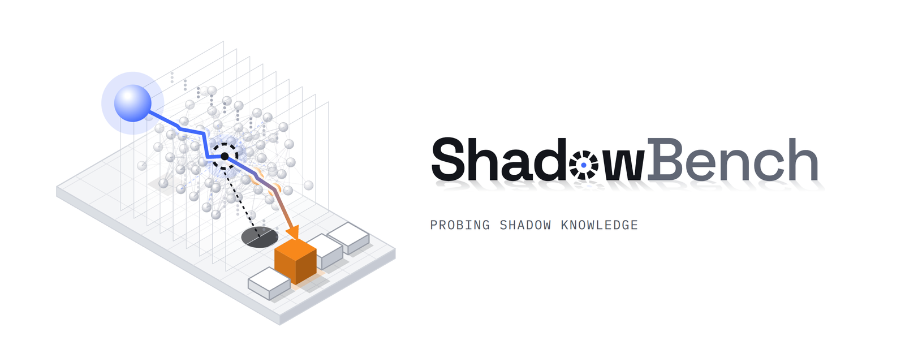
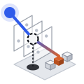

<!-- TODO: add the NeurIPS 2026 paper page link (Paper badge) once it is live; confirm the project-page URL once GitHub Pages is enabled. -->
<p align="center">
  <picture>
    <source media="(prefers-color-scheme: dark)" srcset="docs/static/images/shadowbench-banner-dark.png">
    
  </picture>
</p>

<h3 align="center">ShadowBench: Exposing Lexical Anchoring and the Illusion of Forgetting in Large Language Models</h3>

<p align="center">
  Sujan Maharjan &middot; Lu Liu<br>
  Department of Computer Science, North Dakota State University<br>
  NeurIPS 2026, Evaluations &amp; Datasets Track
</p>

<p align="center">
  
  <a href="https://sujanw0w.github.io/ShadowBench/"></a>
  <a href="https://huggingface.co/collections/sujan-maharjan/shadowbench-datasets"></a>
  <a href="LICENSE"></a>
</p>

#  ShadowBench: Framework for Latent Entity Association and Unlearning Evaluation

ShadowBench is a diagnostic framework designed to evaluate the "Shadow Knowledge" of Large Language Models (LLMs). This repository contains the complete pipeline for dataset construction, baseline knowledge probing, and the evaluation of Machine Unlearning algorithms using latent associative metrics.

## 📌 Overview

Traditional benchmarks rely on **Lexical Anchors** (explicit names) to retrieve facts. We find that LLM knowledge is _lexically anchored_: models possess extensive factual information but find it significantly difficult to retrieve without explicit name tokens. ShadowBench evaluates **Latent Entity Association** through a **Dual-Trait Association (DTA)** task: given an anonymized description of an entity (Trait A), the model must pick the answer that describes the same hidden entity (Trait B) among hard-negative distractors. Our pipeline implements iterative "Adversarial Hardening" (v1 to v3) to prevent models from using non-semantic shortcuts (heuristics) to solve association tasks.

Two findings from the paper, which this repository is used to study:

- **The Shadow Gap:** accuracy drops when the entity name is removed (ShadowBench) compared to when it is given (Direct QA), across all model scales.
- **The Illusion of Forgetting:** we apply ShadowBench to Machine Unlearning and introduce the **Latent Entity Leakage Rate (LELR)**, which detects whether an "unlearned" reasoning model still reconstructs the forgotten entity in its reasoning trace.

Datasets are hosted on Hugging Face: see [ShadowBench](https://huggingface.co/datasets/sujan-maharjan/ShadowBench) (the benchmark) and [SB-Unlearning](https://huggingface.co/datasets/sujan-maharjan/SB-unlearning) (forget/retain corpora and shadow probes for unlearning), or the [collection](https://huggingface.co/collections/sujan-maharjan/shadowbench-datasets).

---

## 📂 Project Structure

```text
ShadowBench/
├── dataset_construction/            # Dataset generation pipeline (v1 to v3)
├── baseline_evaluation/             # Factual recall and associative benchmarks
├── unlearning/                      # Corpora generation for unlearning training
├── unlearn_evaluation/              # Metrics and probes for unlearned models
├── docs/                            # Project website (GitHub Pages)
├── requirements.txt                 # Python dependencies
├── .env.example                     # Template for API keys (OpenAI, Gemini, Anthropic)
└── LICENSE                          # MIT
```

---

## 🛠 Installation

1. Clone the repository:
    ```bash
    git clone https://github.com/sujanW0W/ShadowBench.git
    cd ShadowBench
    ```
2. Install dependencies:
    ```bash
    pip install -r requirements.txt
    python -m spacy download en_core_web_sm
    ```
3. Configure your environment variables in a `.env` file (see `.env.example`): `OPENAI_API_KEY`, `GEMINI_API_KEY`, and `ANTHROPIC_API_KEY`.
4. For dataset construction, download the NLTK sentence tokenizer used by `extraction_script.py`.

---

## 🏗 1. Dataset Construction Pipeline

The construction of ShadowBench follows a three-stage process: **Entity Stratification**, **Semantic Hardening**, and **MCQ Construction**.

**Stage 1: Entity Stratification**

1.  **Entity Discovery:** `wiki_crawler.py` identifies candidate entities via a Breadth-First Search (BFS) of Wikipedia categories.
2.  **Popularity Scoring:** `wiki_analytics.py` fetches metadata (page views, reference count, content length) and `popularity_ranker.py` combines their within-domain percentile ranks into a popularity score (0.5 views + 0.3 references + 0.2 length). In the paper, the top 10% of entities form the **Upper Tier** (Head) and the bottom 10% (that still meet a minimum content length) form the **Lower Tier** (Tail); this tier selection is applied to the ranking after `popularity_ranker.py` runs.

**Stage 2: Semantic Hardening**

3.  **Factual Mining:** `extraction_script.py` utilizes NER filtering to extract dense factual anchors and replaces the entity name with "the subject" (v1). `manual_audit.py` is an interactive command-line tool for manually accepting, rejecting, or editing each fact, so that each retained fact maps to a unique entity.
4.  **Adversarial Hardening:**
    - `pronoun_anonymize.py`: Neutralizes gendered pronouns to "the subject" (v2).
    - `extract_gender.py`: Infers each entity's gender (from pronoun counts on its Wikipedia page) to enable gender-homogeneous distractor matching (v3).

**Stage 3: MCQ Construction**

5.  **MCQ Synthesis:** `generate_qa_with_era.py` produces the final Dual-Trait Association (DTA) probes. It pairs the facts of each entity combinatorially and draws distractors from other entities, using a **Generational Proximity Filter (GPF)** to match distractors within a 25-year window and the gender map for demographic homogeneity.

6.  **Control Sets:**
    - `sensitivity_test.ipynb`: Generates a balanced 1:1 entity-matched subset.
    - `direct_knowledge_text.py`: Reverts anonymization to create a "Direct QA" ceiling baseline.

---

## 📊 2. Baseline Evaluation

We evaluate the "Shadow Gap" between direct recall and latent association across various model scales: Llama-3-8B-Instruct, Qwen3-8B, GPT-5.4-mini, GPT-5.4, and Claude-Sonnet-4.6.

- **Local Models:** `baseline_evaluation_multigpu.py` runs Llama-3-8B-Instruct (`meta-llama/Meta-Llama-3-8B-Instruct`) or Qwen3-8B (`Qwen/Qwen3-8B`) with one model replica per GPU (data-parallel inference). Set `MODEL` (`"llama"` or `"qwen"`), `REASONING` (Standard vs. Chain-of-Thought), `DOMAIN`, and `TIER` at the top of the script. It saves per-question predictions and prints the overall accuracy.
- **Frontier Models:** `gpt_evaluation.py` (default `gpt-5.4`) and `claude_evaluation.py` (default `claude-sonnet-4-6`) query the proprietary APIs asynchronously and save each model's predicted option; set `MODEL`, `DOMAIN`, and `TIER` at the top of each script.

---

## 🧹 3. Machine Unlearning

We utilize the ShadowBench framework to expose the "Illusion of Forgetting" in current unlearning paradigms.

1.  **Corpus Generation:** `unlearning/forget_set.py` (target entity, `TARGET_ENTITY`) and `unlearning/retain_set.py` (neighbor entities) utilize the Gemini API (`gemini-2.5-flash`) to synthesize explicit, name-driven QA sets from Wikipedia content, splits them into train/test sets and mixes in Alpaca samples for the retain set. The corpora used in the paper are released as [SB-Unlearning](https://huggingface.co/datasets/sujan-maharjan/SB-unlearning).
2.  **Optimization:** We leverage the [Open-Unlearning](https://github.com/locuslab/open-unlearning) framework to apply (the training itself is run with Open-Unlearning and is not part of this repository; see Appendix F of the paper for the hyperparameters and checkpoint selection):
    - Gradient Ascent (GA)
    - Gradient Difference with KL-minimization (GD+KL)
    - Negative Preference Optimization (NPO+KL)

---

## 🔍 4. Shadow Evaluation Suite

Located in `unlearn_evaluation/`, this suite probes unlearned models for residual latent knowledge.

- **`main.py`:** a registry-driven evaluator (`--model_path`, `--subset`, `--split`, `--output_name`, `--metrics`, `--baseline_json`) that writes results to `results/`. Available metrics:
    - `generation`: ROUGE scores and exact match on direct forget/retain questions.
    - `probability`: answer-only cross-entropy loss and Perplexity (PPL).
    - `utility`: perplexity over full utility text.
    - `ks_test`: Kolmogorov-Smirnov test of per-sample losses against a baseline run (`--baseline_json`).
    - `shadow_mcq`: multiple-choice **Accuracy** on anonymized traits.
- **`multi_gpu_shadow_eval.py`:** data-parallel evaluation of the shadow multiple-choice probes with Chain-of-Thought followed by a forced choice. It reports:
    - **Accuracy:** Multiple-choice performance on anonymized traits.
    - **Probability Margin:** Confidence gap between correct and incorrect options.
    - **Latent Entity Leakage Rate (LELR):** the fraction of questions whose reasoning trace contains the forbidden entity (case-insensitive match of the full name or last name).

> **Data inputs:** the shadow probes are released as the `*_shadow_forget` and `*_shadow_retain` configurations of [SB-Unlearning](https://huggingface.co/datasets/sujan-maharjan/SB-unlearning).

---

## 📜 Citation

```bibtex
% PLACEHOLDER: replace with the official NeurIPS 2026 entry once it is available.
@inproceedings{maharjan2026shadowbench,
  title     = {ShadowBench: Exposing Lexical Anchoring and the Illusion of Forgetting in Large Language Models},
  author    = {Maharjan, Sujan and Liu, Lu},
  booktitle = {Advances in Neural Information Processing Systems (NeurIPS), Evaluations and Datasets Track},
  year      = {2026}
}
```

---

## 🙏 Acknowledgments

We thank the Center for Computationally Assisted Science and Technology (CCAST) at North Dakota State University for HPC resources.

---

## ⚖️ License

This codebase is licensed under MIT. See the [`LICENSE`](LICENSE) file for details.

The ShadowBench dataset is derived from Wikipedia and is licensed under CC BY-SA 4.0.
